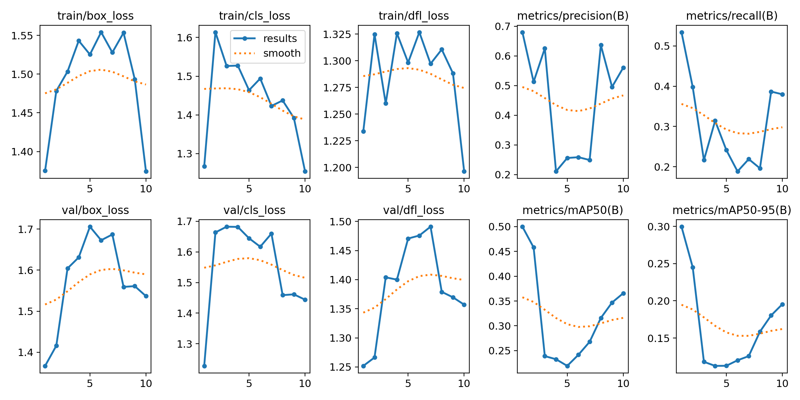

# Deteksi Person, Motorcycle, dan Bus dengan YOLOv8n

Praktik Terpadu RET503 Minggu 4-7

Nama: Aji Arsad
NIM: 4222411006

## Tentang proyek

Repositori ini berisi hasil praktik deteksi objek menggunakan YOLOv8n. Objek yang dideteksi ada tiga: person, motorcycle, dan bus. Datanya diambil dari subset COCO, lalu diperiksa anotasinya, dikonversi antar format, dibagi menjadi train, val, dan test, kemudian dipakai untuk melatih model.

## Isi repositori

- `00_ambil_subset_coco.py`: mengambil subset COCO untuk tiga kelas di atas
- `01_cek_anotasi.py`: memeriksa anotasi
- `02_yolo_ke_coco.py`: mengubah anotasi dari format YOLO ke COCO
- `03_coco_ke_yolo.py`: mengubah anotasi dari format COCO ke YOLO
- `05_split_dataset_yolo.py`: membagi dataset menjadi train, val, dan test
- `06_latih_bandingkan.py`: melatih tiga eksperimen dan membandingkan hasilnya
- `hasil_praktik_<NIM>.txt` dan `.csv`: hasil perbandingan eksperimen
- `results.png`: grafik hasil pelatihan

## Cara menjalankan

Instal dulu library yang dibutuhkan:

```
pip install ultralytics
```

Skrip dijalankan berurutan dari `00` sampai `05` untuk menyiapkan dataset. Setelah itu pelatihan dijalankan dengan:

```
python 06_latih_bandingkan.py --nim 4222411006 --nama "Aji Arsad" --data dataset_v2/data.yaml --model yolov8n --epochs 10 --imgsz 320 --batch 4 --ubah imgsz=416
```

Kalau tidak ada GPU, tambahkan `--device cpu`.

## Eksperimen

Ada tiga eksperimen dengan pengaturan yang sama kecuali yang disebutkan:

1. E1: YOLOv8n dengan bobot pretrained COCO, sebagai pembanding dasar.
2. E2: arsitektur yang sama tetapi bobot acak (dilatih dari nol).
3. E3: sama seperti E1, tetapi ukuran gambar dinaikkan dari 320 ke 416.

Pengaturan umum: epochs 10, imgsz 320, batch 4.

Model terbaik dipilih berdasarkan mAP50-95 pada data validasi, lalu diuji satu kali pada data test.

## Hasil

| Eksperimen | mAP50 | mAP50-95 | Precision | Recall |
|---|---|---|---|---|
| E1 pretrained | 0.427 | 0.282 | 0.696 | 0.293 |
| E2 scratch | 0.004 | 0.001 | 0.002 | 0.087 |
| E3 imgsz=416 | 0.499 | 0.298 | 0.662 | 0.548 |

E3 punya mAP50-95 validasi tertinggi, jadi dipilih sebagai model akhir. Pada data test hasilnya mAP50 0.536 dan mAP50-95 0.379.

## Catatan

E2 hampir tidak mendeteksi apa-apa. Itu wajar, karena model dilatih dari nol hanya 10 epoch dengan data yang sedikit, sedangkan model pretrained sudah membawa bekal dari COCO.

Pada E3, recall naik cukup jauh (0.293 menjadi 0.548) dan mAP50 ikut naik. Harganya waktu latih dan waktu inferensi yang lebih lama (sekitar 2.8 menit menjadi 4.0 menit, dan 18.3 ms menjadi 26.7 ms per gambar).

# AJI-ARSAD-4222411006-PJ1
Praktik YOLO RET503 Minggu 4–7: deteksi objek person, motorcycle, dan bus menggunakan YOLOv8n.
